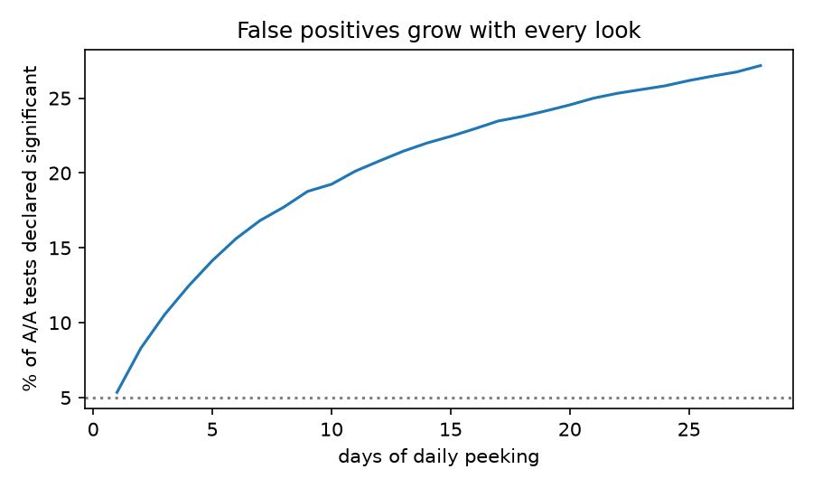

# A/B Testing Playbook

The decisions that make or break an experiment, each one backed by a simulation instead of a rule of thumb. The setting is an operations team testing changes to an internal task workflow, such as earlier reminders for tasks near their deadline, with on-time completion as the primary metric.

Author: Junyi (Stanley) Ye · [jyye.org](https://jyye.org) · Full results: [`results/report.md`](results/report.md)

## What the simulations show

| # | Decision | What goes wrong if you skip it | Simulated result |
|---|---|---|---|
| 1 | Size the test from the smallest lift that would change the decision | Underpowered tests that "find nothing" | 81% baseline: 2,514 tasks per arm for a 3-point lift, 23,665 for 1 point |
| 2 | Check the sample ratio before reading results | Broken assignment or logging passes as a treatment effect | 10,000 vs 10,500 on a 50/50 split: p = 0.0005, stop and investigate |
| 3 | Analyze at the unit of randomization | Team-level assignment analyzed per task | False positives 38.3% with a naive z-test vs 6.5% with cluster-robust errors (nominal 5%) |
| 4 | Use pre-period data (CUPED) | Wider intervals than necessary | ρ = 0.7 cuts variance by 49%, the same as doubling the sample |
| 5 | Don't stop at the first p < 0.05 | Daily peeking on a fixed-horizon test | 27.2% false positives vs 4.7% when read once as planned |
| 6 | Correct for multiple metrics | Ten secondary metrics, no real effects | 39.8% chance of a false "win" uncorrected, about 5% with Holm or Benjamini–Hochberg |
| 7 | Report a full readout | A p-value with no interval or guardrail | Example: +6.2 pts on-time completion (95% CI +4.6 to +7.9), guardrail within tolerance |



## Checklist I use before launch

1. **One primary metric.** Write down its exact definition and denominator, plus the guardrails and their tolerances.
2. **The minimum lift that would change the decision.** Size the test from it, and apply the design effect if randomizing clusters.
3. **The randomization unit.** Pick the unit where spillover stops. Shared queues mean teams, not tasks.
4. **A pre-period covariate for CUPED**, measured before assignment.
5. **A fixed read date**, or a sequential design if monitoring is required.
6. **A sample ratio check** before anything else on read day.
7. **The readout:** effect, interval, guardrails, and what the test cannot tell you.

## Run it

Requires [uv](https://docs.astral.sh/uv/). All simulations are seeded and reproduce exactly. A full run takes about two minutes.

```bash
uv sync
uv run python playbook.py   # writes results/report.md and results/figures/
```

## License

MIT. All data is simulated in `playbook.py`.
