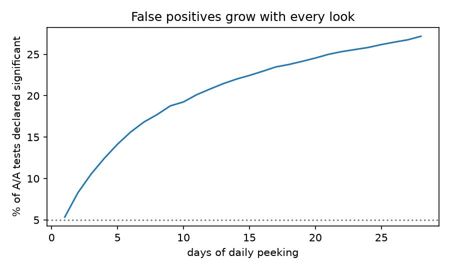

# A/B Testing Playbook: Results

All numbers come from simulations in `playbook.py` (seeded, so they reproduce exactly).

## 1. Size the test before you run it

Baseline on-time completion is 81%. How many tasks per arm are needed to detect a given absolute lift with 80% power at a two-sided 5% level?

| Minimum detectable lift   | Tasks per arm   |
|:--------------------------|:----------------|
| 1 pts                     | 23,665          |
| 2 pts                     | 5,789           |
| 3 pts                     | 2,514           |
| 5 pts                     | 861             |

Halving the detectable lift roughly quadruples the sample. Pick the smallest lift that would change the decision, not the smallest lift you can imagine. Under cluster randomization (section 3), multiply by the design effect.

## 2. Check the split before reading results (sample ratio mismatch)

A 50/50 test that lands 10,000 vs 10,500 tasks looks close. A chi-square test against the planned split says otherwise.

- 10,000 vs 10,090: chi-square p = 0.525 → consistent with 50/50
- 10,000 vs 10,500: chi-square p = 0.000479 → investigate before analysis

Use a strict threshold (p < 0.001) because this check runs on every test. A mismatch usually means assignment or logging is broken, and the treatment effect cannot be trusted until it is fixed.

## 3. Randomize at the level where outcomes are correlated

Tasks are handled by 60 teams whose on-time rates differ. If whole teams are assigned to an arm but the analysis treats every task as independent, false positives explode. 1,000 simulated A/A tests (no true effect), 60 teams × 80 tasks:

| Analysis                               | False positive rate   |
|:---------------------------------------|:----------------------|
| Task-level z-test (wrong)              | 38.3%                 |
| Cluster-robust standard errors by team | 6.5%                  |

The nominal rate is 5%. Cluster-robust errors land slightly above it here because 60 clusters is a small number; a small-sample correction or a cluster bootstrap closes most of the gap. The fix is to analyze at the unit of randomization: cluster-robust errors, a team-level analysis, or a cluster bootstrap. Better still, randomize individuals when spillover allows it, because cluster designs need far more tasks for the same power.

## 4. Use pre-period data to cut variance (CUPED)

Processing time per employee is noisy, but it is strongly correlated with the same employee's time before the test. Adjusting for it shrinks the confidence interval without more traffic. 500 simulated tests, 2,000 employees, true effect −0.4 hours:

| Estimator           | Avg 95% CI width (hours)   |
|:--------------------|:---------------------------|
| Difference in means | 0.70                       |
| CUPED-adjusted      | 0.50                       |

Variance reduction: 49% (theory: ρ² = 49%), equivalent to running the test on about 2.0× the sample. The covariate must be measured before assignment.

## 5. Don't stop the test the first time p < 0.05

Checking a fixed-horizon test every day and stopping at the first significant result inflates false positives. 4,000 simulated A/A tests, 28 daily looks, 300 tasks per arm per day:

| Decision rule                 | False positive rate   |
|:------------------------------|:----------------------|
| Read once at day 28 (planned) | 4.7%                  |
| Stop at first daily p < 0.05  | 27.2%                 |

If you need to monitor, use a sequential method designed for it (alpha spending or always-valid p-values) and monitor guardrails, not the primary metric.

## 6. Many metrics, one decision: control the error rate

A readout with 10 secondary metrics and no real effects will usually show something "significant". 5,000 simulated readouts:

| Method             | P(at least one false positive)   |
|:-------------------|:---------------------------------|
| No correction      | 39.8%                            |
| Bonferroni         | 5.2%                             |
| Holm               | 5.2%                             |
| Benjamini–Hochberg | 5.3%                             |

Decide on one primary metric before launch. Treat secondary metrics as context, corrected with Holm when a decision depends on them, or Benjamini–Hochberg when screening many.

## 7. A complete readout

One simulated test of earlier reminders, randomized by employee (no shared queues), 4,000 tasks per arm. The guardrail is notifications per employee per week.

| Metric                                      | Control   | Treatment   | Difference (95% CI)     | p     |
|:--------------------------------------------|:----------|:------------|:------------------------|:------|
| On-time completion (primary)                | 80.2%     | 86.5%       | +6.2 pts (+4.6 to +7.9) | 6e-14 |
| Notifications per employee-week (guardrail) | 5.93      | 6.20        | +0.26                   | 0.14  |

Recommendation template: ship if the primary metric's interval excludes zero and the guardrail moves less than the pre-agreed tolerance (here, +10% notifications). Report the interval, not just the p-value, and state what the test cannot tell you (for example, effects beyond the test window).
